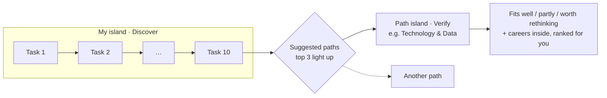
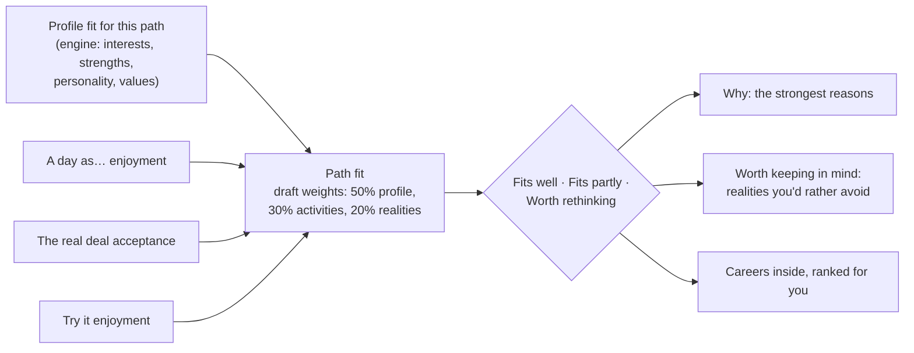

# Discover and Verify: the assessment as island tasks

Status: design, decided by the founder on 12 Oct 2026; for psychologist review. It replaces the five long stations (145 questions) for the pilot (15 Nov) and launch. It builds on the [world spec](world-spec.md) (islands, bridges, levels) and keeps everything in [docs/system](../system/README.md) about data, privacy and the engine.

## 1. Decisions (12 Oct 2026)

| Topic | Decision |
|---|---|
| Path | A **career-group island**: one of the 12 groups (Health & Medicine, Engineering, Technology & Data…) |
| Step 1: **Discover** | On the user's own island. A general assessment of **interests, strengths and key personality traits** that **suggests paths** |
| Step 2: **Verify** | On a path island. **Path-specific tasks**, plus personal questions **asked once** and reused, that check whether the path fits |
| Task size | **5–10 questions**, **mixed question types**, meant to be fun and make users curious |
| Pilot | **Both steps**, with Verify ready for **all 12 paths** (the first 4, Technology & Data, Business & Finance, Engineering, Health & Medicine, on 12 Oct; the other 8 on 14 Oct) |
| Path content | Drafted by Claude in Arabic and English, **reviewed and approved by the psychologist** |
| Shorter questionnaires | Ask the psychologist about shorter published versions (section 8) |

## 2. The idea in one picture

- Only **my island** holds the general personal questions. Path islands hold questions about **that path**.
- Users can verify any path, not only the suggested ones (the world spec cap of 3 active paths applies).
- Nothing is a verdict. A path that "doesn't fit" is described as "worth rethinking", with reasons.

## 3. Rules for tasks

1. **5–10 questions per task**, about 1–2 minutes. Each task is one bridge plank.
2. **Mixed formats inside a task.** Variety comes from presentation, not from changing what a validated question asks.
3. **Validated questions keep their wording and answer scale** (interests 1–5, personality 1–5, strengths self-rating). Only how they look changes: swipe cards, five faces, a slider. A validated question is never turned into a this-or-that or a quiz.
4. **New, playful formats are for path questions** (section 5), which are our own and scored our own way.
5. **Every task ends with a small reward:** the island grows, a fact about a career, or "what this says about you so far". No scores, no grades.
6. Any task can be paused; answers save as they're given (as today).
7. **Results, rewards and the map follow [guidance-rules.md](guidance-rules.md):** keep enjoyment, task performance, familiarity and confidence apart; unknown is never low; XP only on a task's first completion and never for an answer; no punishment for archiving or changing your mind.

### Question formats

| Format | Looks like | Used for |
|---|---|---|
| Swipe | Card, swipe right "I'd enjoy this" / left "not for me", up "love it" (1–5) | Interests |
| Faces | Five faces from "not me at all" to "so me" (1–5) | Personality |
| Slider | "How strong are you at…?" (self-rating scale) | Strengths |
| Card sort | Drag cards into must have / nice to have / don't care, then order the top | Work values |
| This or that | Two options, pick one | Path realities |
| Story | A short "day as a…" moment, then "how does that sound?" | Path activities |
| Scenario | A work situation with 3–4 ways to respond | Path work style |
| Try it | A small puzzle or task from the path, then "did you enjoy that?" | Path taste test |

## 4. Discover (my island)

**Questions:** all **60 interest activities** (10 per type), the **12 strengths**, a **20-question personality set** (section 8) and one attention check: about 93 questions in **10 tasks of 9–10**.

**How tasks are built:** each task has 6 interest cards (one of each type R, I, A, S, E, C, in a varied order), 1–2 strengths and 2 personality statements. Because every task covers every interest type evenly, the interest picture fills in steadily.

| After | What the user sees |
|---|---|
| Each task | My island grows; a short neutral note ("You've told us about 30 activities so far") |
| Task 4 | **Early guess:** "So far you lean toward…", plus the top paths shown faintly, labelled as an early guess |
| Task 8 | Interests can be scored (80% of each type answered): **suggested paths** appear |
| Task 10 | Final suggestions with "why": top 3 paths light up on the map |

**Path ranking:** each group's score is the **average fit of its 3 best careers** for the user (more stable than its single best career). It uses interests, strengths and the short personality set; values aren't asked yet. This answers world spec open question 3; the psychologist can change it.

## 5. Verify (a path island)

### 5.1 Asked once, at the first path

| Task | Questions | Why once |
|---|---|---|
| **What you need from work** | The 21 values cards, sorted, then the top ones ordered (1–2 tasks) | Values are about the person, not the path |

If the psychologist wants the full personality set (all 50 statements) instead of the short one, the remaining 30 also go here, as 3 tasks of 10.

### 5.2 Per path: 3 tasks

| Task | Format | Questions | Measures |
|---|---|---|---|
| **A day as…** | Story | 5–6 moments from a typical day, each with "sounds great / OK / not for me" | Enjoyment of the path's everyday activities |
| **The real deal** | This or that | 6 trade-offs that come with the path (study length, hours, people vs. things, pressure, pay path, where the jobs are) | Acceptance of the path's realities |
| **Try it** | Scenario + Try it | 2 work situations and 2 small puzzles from the path, each followed by "did you enjoy that?" | Taste for the path's kind of problems and work style |

Puzzles are **taste tests, not tests**: what counts is whether the user enjoyed them. A right answer gets a cheerful reaction; a wrong one shows the answer with no mark.

### 5.3 The result

- **Bands, not numbers:** "fits well", "fits partly", "worth rethinking". The cut-offs are set by the psychologist after the pilot; drafts are 0.65 and 0.45.
- **Realities can point to specific careers.** For example, "You'd rather not do night shifts: common for doctors and nurses, rarer for pharmacists in industry or lab scientists." Each reality question is tagged with the careers it applies to, so it adjusts those careers' order without removing any.
- **Re-verifying** later (after more answers, or a change of mind) replaces the path result; the old one stays in history.

## 6. Content to write (pilot: all 12 paths)

For each path: about 6 story moments, 6 this-or-that pairs, 2 scenarios and 2 puzzles, about 16 items, in Arabic (with feminine forms) and English, each tagged with what it measures and the careers it applies to. Source material: the career pages in `packages/content/careers/pages` (tasks, routes, Egypt market).

| Path | Careers inside |
|---|---|
| Technology & Data | 10 (software engineer, data scientist, AI engineer, cybersecurity, cloud/DevOps, mobile, game developer, UX, IT support, product manager) |
| Business & Finance | 9 (accountant, auditor, banker, financial analyst, actuary, management consultant, entrepreneur, HR, supply chain) |
| Engineering | 10 (civil, architect, mechanical, electrical, communications, mechatronics, petroleum, chemical, biomedical, renewable energy) |
| Health & Medicine | 10 (physician, dentist, pharmacist, nurse, physical therapist, clinical nutritionist, medical lab, radiology, clinical psychologist, veterinarian) |
| Marketing & Media | 7 (digital marketer, brand manager, content creator, journalist, PR, film producer, social media manager) |
| Creative & Design | 6 (graphic, interior and fashion designer, 3D animator, photographer, musician) |
| Law & Public Service | 5 (lawyer, judge/prosecutor, diplomat, political scientist, police/military officer) |
| Education & Social | 5 (teacher, special education, school counselor, social worker, translator) |
| Science & Research | 6 (biotechnologist, chemist, physicist, environmental scientist, geologist, Egyptologist) |
| Tourism & Hospitality | 6 (tour guide, hotel manager, chef, event planner, flight attendant, pilot) |
| Skilled Trades & Technical | 5 (electrician, automotive/EV technician, solar technician, industrial technician, CNC operator) |
| Agriculture & Food | 3 (agricultural engineer, food scientist, agribusiness manager) |

Path questions are **drafts until the psychologist approves them**. In the pilot, the research answer sets (opt-in) include them, so their behaviour can be checked.

## 7. What changes elsewhere

| Area | Change |
|---|---|
| Map | My island's bridge shows Discover tasks as planks; suggested path islands light up; each path island's bridge shows its Verify tasks. The 3D/2D map and list view from the island prototype become the main screen. |
| Readiness check | Baseline **before Discover task 1**; follow-up after the first Verify result (timing to settle against the 17 Dec data freeze). The after-results check is dropped or kept as a third point (to decide). |
| Results | "My island" shows the profile and suggested paths; each path shows its Verify result and careers. The current results pages become sections of my island. |
| Statistics | The summary adds which paths were verified and their bands (no answers). |
| Research | Answer sets include path answers. |
| Pilot plan | Session 1: first start, baseline, Discover (about 15 minutes), the first Verify. At home: more paths. **Completion = Discover finished + at least one path verified.** |
| Consent texts | No change in what leaves the phone; wording to mention "tasks" instead of "four parts". |
| Engine | New: path ranking, path fit from path items, career adjustments from realities. Existing scoring and matching unchanged. |

## 8. For the psychologist

1. **Short personality set:** use the **Mini-IPIP** (20 items, 4 per trait)? To our knowledge its items come from the IPIP-50 we already use. Please confirm the item list, and whether 4 items per trait is enough for path verification.
2. **Interests:** keep all 60, or use a shorter published version if one suits?
3. **Values:** is the 21-card sort, asked once at the first path, the right place?
4. **Path items:** review and edit the drafts for the 12 paths (wording, cultural fit, what each item measures).
5. **Path fit:** the draft weights (50 / 30 / 20) and band cut-offs (0.65 / 0.45).
6. **Early guess after task 4:** acceptable, if clearly labelled as early?
7. **Readiness statements:** reword for 18–25 (see [system flows §9](../system/flows.md#9-readiness-check)).
8. **The interest items are a modified O\*NET tool.** We changed the checklist to a 1–5 scale, translated the items, adapted ip_A08 and split the 60 items into 10 tasks. The O\*NET Tools Developer License asks for a validation study before a modified tool is introduced, plus a notice in the app (lawyer brief P10). Is splitting the items across Discover tasks acceptable, and what would a proportionate validation look like for the pilot and for launch?
9. **Scenario answers carry hand-set `fit` values** (0 to 1 per option, e.g. 0, 0.2, 0.8, 1, in `packages/content/paths/*.json`), and they count towards the path fit. Keep them, set them, or count only the "did you enjoy that?" answer, as the puzzles do?
10. **Rules for wording results:** please check [guidance-rules.md](guidance-rules.md) §1, what a result may and may not say from each kind of answer.

**Needed by 27 Oct** for the pilot build.

## 9. Build status

| Week | Item | Status |
|---|---|---|
| 1 (13 Oct) | Discover: 10 tasks from the existing questions (`lib/journey/discover-plan.ts`), mixed formats (swipe, faces, slider), saved on the phone | **Built**, at `/journey` |
| 1 | Short personality set (Mini-IPIP, 20 of the 50 items), scored when the full set isn't answered | **Built** (`personalityShort()`; result records `personalitySet`) |
| 1 | Path suggestions: early guess after task 4, suggestions after task 8, group rank = average of the 3 best careers; "no path stands out" when interest answers are flat | **Built** (`previewSuggestions`, `rankGroups`) |
| 1 | Verify question formats: story, this or that, scenario, puzzle with reveal, "did you enjoy that?" | **Built**; try them at `/dev/paths`. Since 14 Oct shown as illustrated cards with a short heading per question (pictures being made: [docs/art](../art/README.md)) |
| 1 | Verify content for all 12 paths, Arabic and English (8 added 14 Oct) | **Drafted**: `packages/content/paths/*.json`; review pack [docs/review/paths-review.md](../review/paths-review.md) |
| 2 (13 Oct) | Verify: values once, the path's 3 tasks saved on the phone, result (draft weights 50/30/20, bands 0.65/0.45), reasons, realities turned down, careers re-ranked with cautions | **Built** at `/journey/[path]` (`lib/journey/verify.ts`) |
| 2 | First full result made when Discover, values and a first path are done; statistics and research (opt-in) sent from it | **Built** (`maybeFinalize`) |
| 2 | Readiness baseline before task 1 (task 1 waits for it unless skipped); follow-up offered 7 days after the first path result | **Built**; the 7 days is a placeholder until the timing is decided |
| 2 | Island map on my island from real progress (suggested paths glow; tapping a path opens Verify); 3D only, the lists cover phones without it | **Built** (`journey-map.tsx`, `map-state.ts`) |
| 2 | `/assessment` redirects to `/journey`; settings (statistics, session, move, delete) moved there; old station hub removed | **Built** |
| 3 (13 Oct) | Statistics add one record per checked path (band) and the results rating; research adds one answer set per checked path (answers, score parts, band) | **Built** (`anon_path_checks`, `anon_ratings`, `research_path_sets`) |
| 3 | Map labels can overlap on small screens (suggested ones now stay on top) | To polish |
| 3 | Psychologist's edits, phone testing, docs and consent texts | To do |

## 10. Open questions for the founder

- Keep the after-results readiness check as a third point, or drop it?
- Follow-up timing versus the 17 Dec freeze: 7 days, or move the freeze?
- Can a user verify a path before finishing Discover? (Proposal: yes, once suggestions appear after task 8.)
