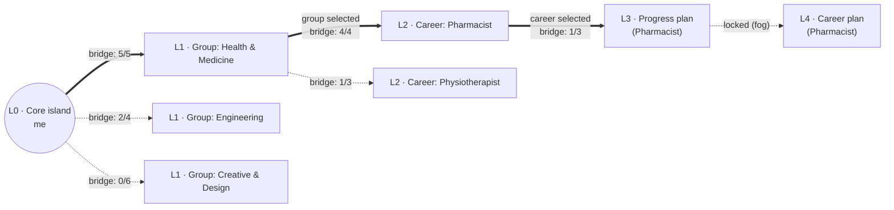

# anaBokra World Spec: Islands, Bridges and Levels

Status: draft for founder and psychologist review · updated 11 Oct 2026 (audience: ages 18–25, students and recent graduates; teens in a later phase) · Prototype: [anaBokra islands](https://anabokra-islands.gentle-plum-8395.chatgpt.site)

anaBokra is a game-like world in which a young adult (18–25, a student or recent graduate) explores careers. They start on their own **core island**, then explore **group islands**, one per career group (the 12 catalog clusters). Inside a group they explore **career islands**, and a selected career grows a **progress plan** and a **career plan**. Each island is reached by **building a bridge** made of phases: assessments, readings, tasks and so on. **All content, phases and their order are set from the admin dashboard.** Nothing about an island is hard-coded in the app.

A bridge shows exploration progress. It does not endorse a career, and finishing it does not qualify anyone for that career.

**Phase 1 (pilot and 16 January launch) is local-first:** everything a student does stays on the device. The server holds content only. Personal data moves to the server in phase 2, after the PDPC license and permits exist (section 4.3).

---

## 1. The world



### 1.1 Levels are rings

| Level | Island | Reached by | Completed when | Unlocks |
|---|---|---|---|---|
| **L0** | Core island ("me") | Always there | Never completes, keeps growing | L1 once the interests phase is done (see 1.4) |
| **L1** | Group islands, one per career group (12) | A bridge from the core island | The user **selects** a group whose bridge is complete | L2 career islands of that group |
| **L2** | Career islands, one per career in a selected group | A bridge from the group island | The user **selects** a career whose bridge is complete | L3 for that career |
| **L3** | Progress plan: what to do *now* (at university, or as a graduate) | A bridge from the selected career island | Plan built and its first goals met | L4 for that career |
| **L4** | Career plan: main route and backups (specialisation, further study, first role) | A bridge from the L3 island | Plan with a main option and backups | L5 (not before launch) |

The same rule applies at every level: **the level unlocks, then the user builds a bridge to reach its island.** Levels, their names and their unlock rules are dashboard-managed (section 3.3).

**Chains per selected career.** L3 and L4 hang off the career the user selected, so each selected career grows outward: Core → Group → Career → Progress plan → Career plan. Two selected careers give two chains, which may come from the same group or from different groups.

**Groups are the 12 catalog clusters** (`packages/content/careers/catalog.json`): Health & Medicine (10 careers), Engineering (10), Technology & Data (10), Business & Finance (9), Marketing & Media (7), Creative & Design (6), Science & Research (6), Tourism & Hospitality (6), Law & Public Service (5), Education & Social (5), Skilled Trades & Technical (5), Agriculture & Food (3). The psychologist can regroup later; a regroup is a content change, not an app change.

### 1.2 Island states

| State | Meaning | On the map |
|---|---|---|
| `locked` | Its level isn't unlocked yet | Fogged silhouette |
| `available` | Unlocked, bridge not started | Visible, no bridge |
| `building` | At least one required step done | Bridge partly built (n / m phases) |
| `reached` | All required steps done | Full bridge, island lit |
| `selected` | L1 and L2 only: the user committed to this group or career | Marked, next ring unlocks |
| `archived` | The user dropped it | Hidden from the map, listed in the core island's history |

### 1.3 User rules

- **Active group islands are capped at 3** (set in the dashboard). Active means `building`, `reached` or `selected`. This keeps users going deep instead of collecting islands. Archived islands don't count.
- **Selected careers are capped at 2** (set in the dashboard), across all groups.
- **Selecting** a group or a career needs a `reached` bridge.
- **Dropping is allowed.** The island moves to `archived` with all progress kept, and the user can restore it from the core island's history if they are under the cap. Archiving a selected career also archives its L3 and L4 islands, and frees one selection.
- **Restoring at the cap** asks the user to archive another island first.
- **Lowering a cap** in the dashboard never archives anything. Users above the new cap keep what they have but can't add more.
- **No fail state.** Steps can be retried, and the copy never presents a result as a verdict on the student.
- **Caps are enforced in the app's progress logic** (phase 1, on the device) and in the database (phase 2), never only in the UI.

### 1.4 The core island and the assessments

The four instruments (interests, personality, values, abilities) are the **phases of the core island**. Each completed one adds a section to the core island's details page ("my interests", "my strengths" and so on).

**Scoring runs on the device.** `@anabokra/engine` is pure TypeScript with no I/O, so it runs in the app:

1. When any instrument is finished, the app re-scores **all** instruments finished so far (latest answers for each).
2. The engine rescales the weights over the parts that exist, and `coverage` says how complete the result is.
3. That result becomes the **current result**. Earlier results are kept in the core island's history.

**Interests unlocks L1.** After the interests phase, the core island suggests groups: each group is ranked by the best fit among its careers, and the top 3 are shown with an explanation. Suggestions sharpen as more instruments are finished. The user can explore any group. (The ranking rule is open question 3.)

**Explanations come from the engine's `reasons`, `watchOuts` and `flags`**, turned into text by templates in Arabic and English. There is **no AI** in phase 1.

Every career belongs to a group, so every match leads to an island. Where a group island isn't written yet, it shows as "coming soon" and the career page still opens.

---

## 2. Island details pages

Every island has a details page, opened by tapping it. Its content comes from the dashboard and the existing content tables.

### 2.1 Core island ("me")

- Profile, stored on the device: nickname, age band, stage (student: faculty and year; or graduate: graduation year), gender if given (for Arabic forms only)
- Sections that unlock as core phases finish: interests, personality, values, strengths, readiness
- Suggested groups and top career matches with an explanation (from the current result)
- My islands: active, selected and archived (with restore)
- History: results over time and finished islands

### 2.2 Group island (L1)

| Section | Content | Source today |
|---|---|---|
| Overview | What the group is about, what people in it do | `clusters.description` (plus a new `summary` field) |
| Careers in this group | Each career with a short summary and how it relates to the user's results | `careers` by `cluster_id`, current result |
| Common routes in | Faculties and specialisations, further study, courses and certificates, typical first roles | `career_country_data.path`, `programs`, `opportunities` |
| Market in Egypt | Overall demand and sectors | Aggregated from `career_country_data.market` |
| Related groups | Groups with overlapping interests | Dashboard-edited |
| Your bridge | Phases and steps with progress | New (section 4) |

### 2.3 Career island (L2)

| Section | Content | Source today |
|---|---|---|
| Overview | What the career is, a day in the life, typical tasks | `careers.summary`, `description`, `tasks` |
| Market in Egypt | Demand, salary ranges, growth, sectors and employers, outlook | `career_country_data.market` |
| Routes in | Specialisations and programs, postgraduate options, courses and certificates, internships and entry-level roles, switching in from another field | `career_country_data.path`, `programs`, `program_careers`, `opportunities` |
| Supporting skills | Hard and soft skills to build, and how to show them (projects, portfolio) | New field on `careers` (dashboard-edited) |
| Resources | Courses, books, videos, competitions, scholarships | `opportunities`, `opportunity_careers` |
| Fit with you | How the career relates to the user's results; never a verdict | Current result |
| Your bridge | Phases and steps with progress | New (section 4) |

### 2.4 Level islands (L3, L4)

- **L3 Progress plan:** goals for the user's current stage: courses and electives, skills, projects, internships, student activities, or for graduates, first applications and short courses. Its steps come from templates tagged with a stage (for example `year-1-2`, `final-years`, `graduate`), so plans differ by stage. When the stage changes, the new stage's steps appear and finished steps stay finished. It is stored in the shape of `roadmaps` + `milestones`.
- **L4 Career plan:** a main route (a specialisation, further study, or a first role) plus backups: certificates, internships, entry-level roles, costs, scholarships, and routes in from a different degree. Stored in the shape of `roadmaps` with `data` holding the chosen route and backups.

Section layouts for level islands are dashboard-defined (`islands.details` in section 4).

---

## 3. Dashboard (everything is configured here)

### 3.1 Template library

A **template** is a reusable piece of work that can be placed in any phase of any island.

| Type | Example | Completion |
|---|---|---|
| `assessment` | Interests inventory (wraps an `instrument_versions` row) | Instrument finished and scored on the device |
| `quiz` | "How much do you know about nursing?" | Submitted (score is optional) |
| `reading` | Article, career story | **Self-marked** "done" (no scroll or time tracking) |
| `video` | Interview with an architect | **Self-marked** "done". Videos are self-hosted or bundled; **no third-party embeds** |
| `task` | "Sketch a room plan", "Interview someone in the field" | **Self-marked** "done". No evidence upload |
| `reflection` | "What surprised you?" | Answer submitted. The answer stays on the device |
| `external` | Online course, school club, event | Self-marked "done" |

- **Tags** organise the library (topic, skill, cluster, stage, difficulty, language). The dashboard can filter and search by tag.
- **Versions:** editing a published template creates a new version. Finished steps keep the version they were done on, so editing never changes past results.
- **Arabic forms:** every template's Arabic text has a feminine variant (`arF`) where the grammar needs one, as the instruments do.
- **Workflow:** `draft → review → published → archived`, the existing `content_status`. Who reviews what is in 3.4.

### 3.2 Islands as projects

Each island (group, career or level) is a **project** built in the dashboard:

- **Island:** name, level, linked cluster (group islands) or career (career islands), visual (shape, colour, icon), details page content, status.
- **Phases:** named, ordered by drag and drop. Each phase is a segment of the bridge.
- **Steps:** template placements inside a phase, in order. Per step:
  - `required` or optional
  - unlock: `sequential` (after the previous step) or `free` (any order within the phase)
  - reuse: `reuse_result` (done elsewhere counts here; the default) or `fresh` (must be done again for this island)
  - pinned template version, or "any version"
  - XP reward
- Phase unlock: sequential by default, or free (set per island).
- An island can't be published with zero required steps.
- **Preview as student** before publishing.

### 3.3 Levels and world settings

- Levels: number, name, unlock rule, which islands belong to the level, multiplicity (one global, or one per selected group or career).
- Settings: active-group cap (3), selected-career cap (2), how many suggested groups to show (3), the copy for fog, "coming soon" and empty states.

### 3.4 Roles and review (existing `admin_role`)

| Role | Can |
|---|---|
| `content_editor` | Draft templates (non-assessment), islands, phases, details pages. Review another editor's drafts |
| `assessment_lead` | Approve assessment templates and **reflection templates**, and their versions |
| `data_curator` | Market data, programs, opportunities |
| `super_admin` | Publish, levels, world settings |
| `analyst` | Aggregate pilot statistics only (no per-student data exists on the server in phase 1) |

Non-assessment content is reviewed by a second `content_editor` before a `super_admin` publishes it. Assessments and reflections also need `assessment_lead` (psychologist) approval.

### 3.5 Editing a published island

Editing a published island bumps `islands.content_version`. On the next content update, each device:

1. **Recalculates** bridge progress against the new steps.
2. Shows an **"island upgraded"** notice on the island, inviting the user to look at the new steps.
3. **Keeps selections and unlocked rings.** A selected group or career stays selected, and L2–L4 stay open, even if its bridge is no longer complete.

Removed steps stop counting. The user's attempts on them stay in history.

---

## 4. Data model

### 4.1 Server: content only (phase 1)

These sit alongside the existing content schema.

```
tags                (id, slug, name i18n, group)
templates           (id, type, title i18n, status content_status, current_version, created_by, …)
template_versions   (id, template_id, version, content jsonb, instrument_version_id?, published_at)
template_tags       (template_id, tag_id)

levels              (id, number, name i18n, unlock_rule jsonb, multiplicity, status)
islands             (id, level_id, kind 'group'|'career'|'level', cluster_id?, career_id?,
                     name i18n, visual jsonb, details jsonb, phase_order 'sequential'|'free',
                     status, content_version)
island_phases       (id, island_id, sort_order, name i18n, description i18n)
phase_steps         (id, phase_id, template_id, pinned_version_id?, sort_order, required,
                     unlock 'sequential'|'free', reuse 'reuse_result'|'fresh', xp_reward)
```

- `kind = 'group'` requires `cluster_id`, `kind = 'career'` requires `career_id`.
- Existing content tables reused: `clusters`, `careers`, `career_country_data`, `programs`, `opportunities`, `instrument_versions`, `achievements`.
- The device downloads published content and caches it for offline use.

### 4.2 Device: the student's data (phase 1)

Stored locally (IndexedDB), in the same shapes as the future server tables so phase 2 can sync them:

```
profiles            (id, display_name?, age_band, stage, faculty?, year?, gender?, locale,
                     event_code?, consent)
user_islands        (id, profile_id, island_id, parent_user_island_id?, state,
                     content_version_seen, unlocked_at, selected_at?, archived_at?, restored_at?)
                     unique (profile_id, island_id, parent_user_island_id)
template_attempts   (id, profile_id, template_version_id, user_island_id?, status,
                     result jsonb, started_at, completed_at)
responses           (profile_id, instrument_version_id, item_id, value, answered_at)
results             (id, profile_id, scores, matches, coverage, quality, created_at)
readiness_checks    (profile_id, phase 'pre'|'post', answers, created_at)
xp_events           (profile_id, points, ref_type, ref_id, created_at)
```

- **Bridge progress is derived, never stored:** finished required steps ÷ total required, grouped by phase.
- **A step is finished** when a completed `template_attempt` exists for its template: on any island for `reuse_result`, or with this `user_island_id` for `fresh`. A pinned step needs an attempt on the pinned version; an unpinned step accepts any version.
- **Chains:** `parent_user_island_id` links a career island to its group, L3 to its career and L4 to its L3.
- **XP and progress never leave the device.** There is no read or watch tracking.

### 4.3 Uploads and devices

| | Pilot session (own phone, event code) | Launch (own phone) |
|---|---|---|
| Profiles | One per device (a loaner phone holds one at a time and is cleared after the session) | One per device |
| Before use | Age question; 18+ accept for themselves; nothing saved for under-18s | Same |
| Uploads | Totals per event code; **only with the user's opt-in:** anonymous answer sets (no ID, no key; event code, age band, stage, language) and readiness pre/post linked by a random code made on the phone | None (open question 2) |
| Results | In the app | In the app |
| End | The user deletes on the device | The user deletes on the device |

The upload endpoint accepts only these three record types, stores no IP address and no device identifier, and receives answer sets in shuffled batches.

**Phase 2** moves the device tables to the server tables of the same names. That needs the PDPC license, a new consent and the server fixes noted in section 8.

---

## 5. App surfaces

| Surface | Pilot (own phones, Nov 2026) | Launch (own phones, 16 Jan 2027) |
|---|---|---|
| World map | 2.5D / low-poly, plus list view | Full 3D polish (camera fly-through, animations), list view kept |
| Core island + details page | Yes | Yes |
| L1 group islands | 3–5 fully written; the rest "coming soon" with career pages open | All 12 |
| L2 career islands | Career pages only, bridges "coming soon" | 15+ with bridges; the rest career pages + "coming soon" |
| L3 progress plan / L4 career plan | Fogged | Yes |
| Archive / restore | Yes | Yes |
| XP and achievements (on device) | Yes | Yes |
| Results explanations | Templates, no AI | Templates, no AI |
| Event code and research opt-in | Yes | No |
| Dashboard: template library, tags, island builder, publish, preview | No, content seeded | Yes |
| Dashboard: level config, world settings | Hard-coded defaults | Yes |

**Replaces:** the current `features/path` four-station path world. The assessment, results, careers and explore features stay and are reached from island details pages.

---

## 6. Pilot build (due 31 October)

Build:

1. **Local store** (section 4.2) and the offline content cache. *Done: on-device store, profiles, repository; assessment pages run from the device.*
2. **First start:** age question, acceptance for 18+, *Delete all my data*. *Done.*
3. **Profile for 18–25:** stage (student or graduate), faculty and year, replacing the school-oriented context questions (curriculum, track, expected score).
4. **Core island** with the four instruments as phases, the readiness check at the start and two weeks after results (in-app prompt), and the "clear and useful" rating right after results.
5. **On-device scoring** with re-scoring after each instrument (1.4) and template-written explanations. *Scoring done; re-scoring per instrument to do.*
6. **Event code, research opt-in and Settings → Research data** (consent texts 2.2–2.4).
7. **Upload endpoint** for totals, anonymous answer sets and linked readiness records (4.3).
8. **Group islands** seeded as fixed content: 3–5 written, the rest "coming soon"; career pages for all 82 careers.
9. **2.5D map and list view**, connected to the real results.

Turned off for the pilot: accounts and WhatsApp sign-in, server consent flows, the AI package, parent and school views, the server-rendered share card, and analytics and crash reporting that could identify a user (open question 6).

---

## 7. Open questions

1. **Career-island cap:** is there a cap on active career islands inside a selected group (proposed: 3, set in the dashboard)?
2. **18+ at launch:** may adults opt in to anonymous uploads, or is nothing uploaded at launch?
3. **Group ranking:** is a group suggested by its best career fit (proposed) or by the average of its top careers? (Psychologist.)
4. **Launch results card:** should the phone app let users save their results as an image or PDF?
5. **Gender on the device:** keep it optional for Arabic grammar only (proposed), or drop it?
6. **Crash reporting:** off, or on with no identifiers and no answers?

**Decided (11 Oct 2026):** phase 1 is for ages 18–25 (students and recent graduates) on their own phones; the pilot runs at universities; teens come later.

**Decided (10 Oct 2026):** one island per catalog cluster; career islands as their own level (L2); chains per selected career; caps of 3 active groups and 2 selected careers; tasks self-marked only; psychologist approves assessments and reflections; nothing after L4 before launch; island edits recalculate progress with an "island upgraded" notice and keep selections; XP on the device with no read or watch tracking; no AI in phase 1.

## 8. Follow-ups outside this spec

- **Legal drafts** (`docs/legal/`) were rewritten for phase 1 on 10 Oct 2026; open questions for counsel are in `docs/legal/lawyer-brief.md`. The phase 2 (server) versions are in git history.
- **Content for 18–25:** reword the readiness items for students and graduates (psychologist); add entry routes (internships, first roles, certificates) to `career_country_data`; remove Thanaweya Amma and school wording from app copy.
- **Teens (later phase):** guardian consent, school pilot material and the teen legal texts are parked in `docs/parked/teens/`.
- **Server fixes needed before phase 2:** `can_view_student_summary` must check the `counseling` scope for school staff; `recordSchoolConsent` must record the optional choices; `analytics_results` must check the `research` scope instead of `data_processing`.
- The domain and support email are still placeholders (`anabokra.app`, `privacy@anabokra.example`) until the domain is bought.
