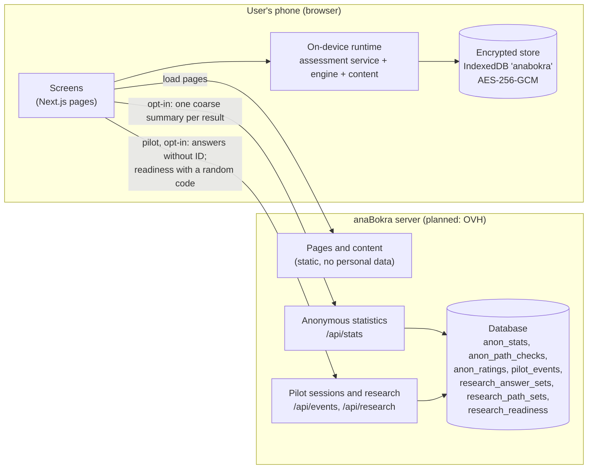

# anaBokra system documentation

Status: as built on 12 Oct 2026 (commit `ad0031f` and later). Owner: founder. Update this folder in the same change as the code it describes.

anaBokra («أنا بكرة», "me tomorrow") helps young people in Egypt explore careers. In phase 1 it serves **ages 18–25 (students and recent graduates)**, plus **15–17**, who accept for themselves (no parent step since 13 Oct 2026). A user answers four short questionnaires on their own phone, sees what they enjoy, how they work, what they value and what they're good at, and gets career matches with plain explanations. Everything they enter stays **on their phone, encrypted**.

## What's in this folder

| Document | Read it for |
|---|---|
| [glossary.md](glossary.md) | The words we use, in English and in the app's Arabic, and the words we avoid |
| [flows.md](flows.md) | Every user flow, step by step, with a diagram |
| [connections.md](connections.md) | How the parts connect: packages, modules, endpoints, what is stored where, what crosses the network, settings |
| [screens.md](screens.md) | Every screen and route, by screen code, with its status |

Related documents elsewhere:

| Document | Topic |
|---|---|
| [../product/world-spec.md](../product/world-spec.md) | The island world (levels L0–L4, bridges, dashboard) and the pilot build list |
| [../product/discover-verify.md](../product/discover-verify.md) | The assessment as island tasks: Discover on my island, Verify on each path island |
| [../product/guidance-rules.md](../product/guidance-rules.md) | What results may say, rewards, what the map means, accessibility, facts about study routes, partners, versions |
| [../gtm/pilot-plan.md](../gtm/pilot-plan.md) | The university pilot: timeline, measures, data |
| [../legal/](../legal/) | Consent texts, privacy policy, terms, compliance map, lawyer brief (all drafts) |
| [../review/GUIDE.md](../review/GUIDE.md) | How the psychologist reviews the question wording |

## Status labels

Every flow and screen in these documents carries one of these labels:

| Label | Meaning |
|---|---|
| **Built** | In the app, tested, works in phase 1 (on-device mode) |
| **Built, gaps** | Works, with known gaps listed next to it |
| **Prototype** | A working demo on a `/dev/...` page, not connected to real data |
| **Designed** | Described in a spec, not built |
| **Phase 2** | Built for the server mode (accounts, Supabase); switched off in phase 1 |
| **Parked** | Kept for later (the school and teen work), not maintained |

## The big picture (phase 1)

**The rule behind the picture:** no personal data is stored on the server or passes through it. Answers, results and the profile never leave the phone (a backup file goes wherever the user saves it). Only two things reach the server, both opt-in:
1. Anonymous statistics.
2. Research data at pilot sessions.

(The parent's phone code and the transfer-code relay were removed on 13 Oct 2026.)

[connections.md](connections.md#what-crosses-the-network) lists exactly what each one carries.

Whether this design needs a licence from Egypt's Personal Data Protection Centre was for the lawyer to decide. **Counsel agreed to the phase 1 design on 13 Oct 2026** (as reported by the founder; written confirmation to be filed with the [lawyer brief](../legal/lawyer-brief.md)). These documents still never claim that encryption or local storage on its own removes that need.

## Two data modes

The same code runs in two modes, chosen by `NEXT_PUBLIC_DATA_MODE`:

| Mode | When | Where personal data lives | Accounts |
|---|---|---|---|
| `local` (default) | Phase 1: pilot (Nov–Dec 2026) and launch (16 Jan 2027) | On the phone, encrypted | None |
| `server` | Phase 2, after the licence and permits | Supabase (Postgres with row-level security) | WhatsApp sign-in, parent and school consent |

The assessment pages check the mode first and use the on-device runtime in `local` mode. The pages that still assume `server` mode (career list, favorites, explore, account) redirect to `/journey` in `local` mode, and the career page hides its fit, favorite and compare parts ([screens.md](screens.md)).

## Phase 1 at a glance

| Area | Status |
|---|---|
| First start: age question, acceptance (18+, and 15–17 for themselves), nickname and optional password | Built |
| Discover (10 short tasks on my island) and Verify (4 paths), replacing the five stations | Built |
| Island map from real progress: Home map card, and the Explore tab with list, search, legend and island sheet | Built (3D devices; lists everywhere) |
| App shell with brand theme and logo: Home · Explore · Saved · Account tabs | Built |
| Add a path to my map (orange bridge) and save paths (Saved tab), both on the phone | Built |
| Results: reveal, profile, career matches with explanations | Built |
| Readiness check | Built: baseline before Discover, follow-up after the first path (timing to settle) |
| Encryption on the phone, delete my data | Built |
| Moving phones: backup file | Built |
| Anonymous statistics (opt-in) | Built |
| Pilot session code, research opt-in | Built |
| Island world beyond paths (L2–L4: career plans) | Designed in the world spec |
| "Clear and useful" rating after results | Designed |
| Career library and explore pages | Built for `server` mode; personal parts not yet on the phone |
