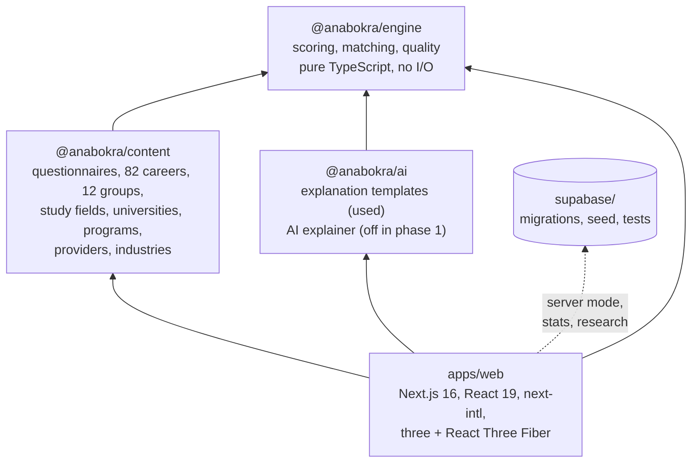
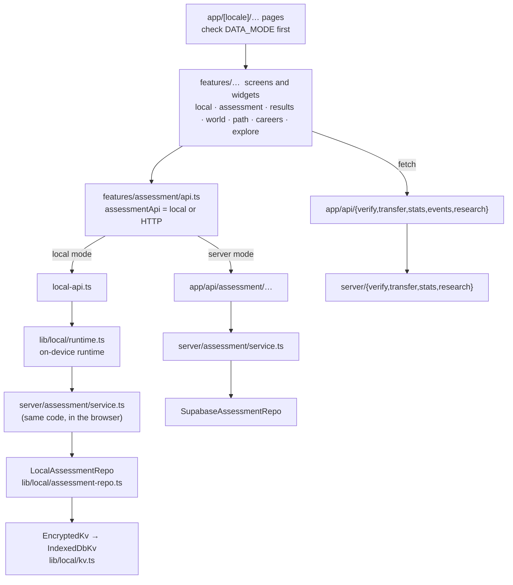

# Connections

How the parts of anaBokra connect: packages, the layers of the web app, what is stored on the phone, each server endpoint, the database tables, what crosses the network, settings, and how to check that it all works. Terms are defined in the [glossary](glossary.md).

---

## 1. Packages

A pnpm monorepo. The engine has no dependencies; everything else builds on it.

| Package | Holds | Notes |
|---|---|---|
| `packages/engine` | `scoring.ts` (Likert, values cards, abilities), `matching.ts` (fit, reasons, watch-outs, context flags, surprising matches), `quality.ts`, `types.ts` (RIASEC, Big Five, work values, ability domains, study fields, stages) | Same code on the phone and on the server |
| `packages/content` | `instruments/*.json` (personality includes the short set), `paths/*.json` (Verify drafts), `careers/` (catalog, generated traits from O*NET, 82 career pages, `study-fields.json`), `opportunities/` (universities, programs, providers), `industries/` | O*NET data is CC BY 4.0, modified by anaBokra |
| `packages/ai` | `templates.ts` (Arabic and English sentences for reasons, watch-outs, flags), `prompt.ts`, `guardrails.ts`, `explain.ts` | The Anthropic client is used only in server mode |
| `apps/web` | Pages, features, the on-device runtime, server services, API routes, messages | See section 2 |
| `supabase/` | 15 migrations, row-level security, seed data, SQL tests | Phase 2 schema, plus the phase 1 statistics and research tables |

---

## 2. Inside the web app

| Folder | Role |
|---|---|
| `app/[locale]/` | Pages in Arabic (`/ar`) and English (`/en`). Assessment pages branch to on-device components in local mode. |
| `app/api/` | Route handlers only (Next.js allows nothing else to be exported from a route file). Shared helpers live in `server/*/http.ts`. |
| `features/local/` | Phase 1 screens: first start, parent consent, journey and result wrappers, settings (statistics, session, move, delete), restore. |
| `features/assessment/`, `features/results/` | Station and results screens, shared by both modes. |
| `features/path/` | The path map and the generated "your world" (3D with a 2D fallback). |
| `features/world/` | The island-world prototype (`/dev/world`). |
| `lib/journey/` | Discover task plan and status. |
| `features/journey/` | Discover page, task player, question formats, path preview. |
| `lib/local/` | The on-device runtime: storage, encryption, profiles, repo, PIN, transfer, statistics and research senders. |
| `lib/` | Shared schemas and helpers used on both sides: `stats-summary.ts`, `research.ts`, `national-id.ts`, `data-mode.ts`. |
| `server/` | Services behind the API: assessment, verify, transfer, stats, research, and the phase 2 auth, consent, admin, careers and explore services. |
| `messages/{en,ar}.json` | All UI text. Arabic keys ending in `F` are the feminine forms. |

**One assessment service, two places.** `createAssessmentService({ repo })` holds every rule (ownership, order, validation, scoring, retake). In local mode it runs in the browser over `LocalAssessmentRepo`; in server mode it runs on the server over Supabase. A rule changed there changes both modes.

---

## 3. On the phone

| Item | Value |
|---|---|
| Database | IndexedDB `anabokra`, store `kv` |
| Encryption | Every value sealed with AES-256-GCM (random 12-byte IV per write) |
| Device key | AES-256, made on the phone, **non-extractable**, kept in a separate IndexedDB `anabokra-key` |
| No IndexedDB (some private windows) | Falls back to memory; the journey page shows a storage warning; data is lost on reload |
| Parent PIN | PBKDF2-SHA-256, 150,000 rounds, random salt; compared in constant time |

**Keys in the store**

| Key | Holds | Moves with a backup | Removed by "Delete all my data" |
|---|---|---|---|
| `active-profile` | Id of the profile in use | — | Yes |
| `profile:{id}` | `LocalProfile`: age band, language, consent (versions, times, statistics and research choices), parent record, session code | Yes | Yes |
| `assessment:{id}` | Sessions, answers (with time taken), results, readiness checks, About you | Yes | Yes |
| `stats:{id}` | Result ids already summarised | Yes | Yes |
| `research:{id}` | Link code; result ids and readiness records already sent | Yes | Yes |

The teaser on the public site (`/try`) keeps its 12 answers in `localStorage` until they're carried into the first station.

---

## 4. Endpoints used in phase 1

All are `POST` with JSON, same-origin only, and run on Node.js.

| Endpoint | Called by | Receives | Keeps | Limits |
|---|---|---|---|---|
| `/api/verify/phone/request` | Parent consent | Phone number, language | 10 min: code hash, last 3 digits, attempts. Never the number. | 3 per number, 20 per address, per hour |
| `/api/verify/phone/confirm` | Parent consent | Request id, code | Nothing after success | 5 tries per code |
| `/api/transfer` | Move to a new phone | Sealed bundle (≤ 2 MB) | Sealed bundle, ≤ 10 min | 10 per address per hour |
| `/api/transfer/claim` | Restore | 8-character code | Deletes the bundle on collection | 30 per address per hour |
| `/api/stats` | Statistics sender | One summary (strict schema) | Row in `anon_stats` + arrival week | 30 per address per hour |
| `/api/events/check` | Join a session | Session code | Nothing | 20 per address per hour |
| `/api/research/answers` | Research sender | One answer set | Row in `research_answer_sets` + arrival week | 300 per address per hour |
| `/api/research/readiness` | Research sender | Link code, phase, answers | Row in `research_readiness` (one per link code and phase) | Same |
| `/api/research/forget` | Turning research off | Link code | Deletes that code's readiness rows | Same |

**Phase 2 endpoints** (switched off in local mode): `/api/auth/*` (codes, callback, sign-out, send-SMS hook), `/api/assessment/*` (sessions, responses, context, complete, finalize, result, readiness, profile), `/api/consent/*` (invites, parent verification, family, school codes and consents, withdraw), `/api/careers/{me,favorites}`, `/api/explore/{me,saved}`, `/api/admin/flags`, and development mocks.

---

## 5. Database tables

**Used in phase 1** (written only by the server with the service role; nobody else can read them):

| Table | Migration | Contents |
|---|---|---|
| `anon_stats` | `20261011000001` | Anonymous summaries: week, age band, stage, language, completion, top 3 lists, bands, session code |
| `pilot_events` | `20261012000001` | Session code, partner, research offered, open and close dates |
| `research_answer_sets` | `20261012000001` | Week, session code, age band, stage, language, versions, answers, values ranking, delete-by date |
| `research_readiness` | `20261012000001` | Link code + phase (key), week, session code, version, language, answers, delete-by date |

**Phase 2 schema** (migrations `20261009000001`–`12`, `20261011000002`): profiles and roles; consent (`consent_invites`, `consents`, `parent_links`, organisations, join codes); assessment (`assessment_sessions`, `responses`, `results`, `readiness_checks`, `instrument_versions`, `instrument_keys`); content (`clusters`, `careers`, `career_country_data`, `industries`, `institutions`, `programs`, `opportunities`, review queue); engagement (`favorites`, `saved_opportunities`, `roadmaps`, `milestones`, XP, achievements, weekly goals, notifications); platform (`feature_flags`, `app_settings`, `audit_log`, `ai_generations`, counselors, subscriptions, bookings). See `supabase/README.md`.

---

## What crosses the network

| Data | Leaves the phone? | Readable by anaBokra? | Identifies the person? | Kept |
|---|---|---|---|---|
| Answers, results, profile, About you | Never in readable form | No | — | On the phone until deleted |
| Parent's national ID, name, PIN | Never | No | — | On the phone |
| Parent's phone number (15–17) | Yes, to send the code | Briefly, in memory | Yes, briefly | Not stored |
| Backup file | Only where the user saves it | No (passphrase) | — | Wherever the user keeps it |
| Transfer bundle | Yes, sealed | No (key stays with the user) | — | ≤ 10 minutes |
| Anonymous statistics (opt-in) | Yes | Yes | No | Kept |
| Research answer sets (opt-in, pilot) | Yes | Yes | No | ≤ 17 Jun 2027 |
| Research readiness records (opt-in, pilot) | Yes | Yes | Pseudonymous (link code only on the phone) | ≤ 17 Jun 2027, or until research is turned off |
| Session code check | Yes (the code only) | Yes | No | Not stored |
| Page requests | Network address, browser | Technical logs | Technically | [to set: not stored or ≤ 7 days] |

How this is described to users: [privacy policy](../legal/privacy-policy.en.md) §4–5. How it's mapped to the law: [compliance map](../legal/compliance-map.md) §0b.

---

## 6. Settings (environment variables)

| Variable | Used for | Phase 1 |
|---|---|---|
| `NEXT_PUBLIC_DATA_MODE` | `local` (default) or `server` | `local` |
| `NEXT_PUBLIC_SUPABASE_URL`, `SUPABASE_SERVICE_ROLE_KEY` | Database for statistics, sessions and research; without them the server keeps these in memory | Needed on the real server |
| `PILOT_EVENTS` | Session codes without a database, e.g. `CU-FCI-1:research,AUC-1` | Development and testing |
| `NEXT_PUBLIC_SITE_URL`, `NEXT_PUBLIC_SUPPORT_EMAIL` | Links and contact | Yes |
| `NEXT_PUBLIC_SUPABASE_ANON_KEY` | Signed-in database access | Phase 2 |
| `OTP_SENDER` (+ its URL or keys) | Sign-in codes: `console`, `openwa`, `whatsappCloud` | Phase 2 |
| `ANTHROPIC_API_KEY` | AI explanations | Off (no AI in phase 1) |
| `CONSENT_*`, `ASSESSMENT_*` | Phase 2 consent limits and development mocks | Phase 2 |

The SMS sender for parent codes has no setting yet: it prints to the log in development and refuses in production until a provider is added.

---

## 7. Checking that it works

| Command or page | What it does |
|---|---|
| `pnpm -r typecheck` | Type checks all packages (the web app first regenerates career pages and route types) |
| `pnpm -r test` | All tests: engine, content, AI templates, web (about 617 in total) |
| `cd apps/web && npx eslint src` | Lint, including React Compiler rules |
| `/en/dev/local` | Runs a demo assessment on the phone, or answers the four stations without finishing; shows what's stored |
| `/en/dev/world` | Island-world prototype |
| `/en/dev/path` | Path-map prototype |
| `/en/dev/engine` | Engine and content smoke test |
| `/en/journey` | Discover (my island) |
| `/en/dev/paths` | Try the draft Verify tasks |
| `pnpm --filter @anabokra/content export:paths` | Regenerates the psychologist's review pack `docs/review/paths-review.md` |

**The dev pages are not hidden in production yet** (see [known gaps](flows.md#known-gaps)). Before launch they should return 404 outside development.
