# User flows

Each flow in phase 1 (on-device mode), step by step, with a diagram, what is stored and what is sent. Words in **bold** are defined in the [glossary](glossary.md). Status labels are explained in the [README](README.md#status-labels).

| # | Flow | Status |
|---|---|---|
| 1 | [First start](#1-first-start) | Built |
| 2 | [Parent consent (15–17)](#2-parent-consent-1517) | Removed 13 Oct 2026 |
| 3 | [The journey and its stations](#3-the-journey-and-its-stations) | Built |
| 4 | [About you](#4-about-you) | Built |
| 5 | [Finishing and scoring](#5-finishing-and-scoring) | Built |
| 6 | [Results](#6-results) | Built |
| 7 | [Pilot session code and research](#7-pilot-session-code-and-research) | Built |
| 8 | [Anonymous statistics](#8-anonymous-statistics) | Built |
| 9 | [Readiness check](#9-readiness-check) | Built, gaps |
| 10 | [Moving to a new phone](#10-moving-to-a-new-phone) | Built |
| 11 | [Delete all my data](#11-delete-all-my-data) | Built |
| 12 | [Island world](#12-island-world) | Prototype / Designed |
| 13 | [Phase 2 flows](#13-phase-2-flows-server-mode) | Phase 2 |
| 14 | [Discover and Verify (replacing the stations)](#14-discover-and-verify) | Built (Discover), Prototype (Verify) |
| 15 | [The tabs](#15-the-tabs) | Built |
| — | [Known gaps](#known-gaps) | — |

---

## 1. First start

**Who:** anyone opening `/journey` (or `/assessment`, which redirects there) on a phone with no profile yet. **Nothing is saved until the user accepts.**

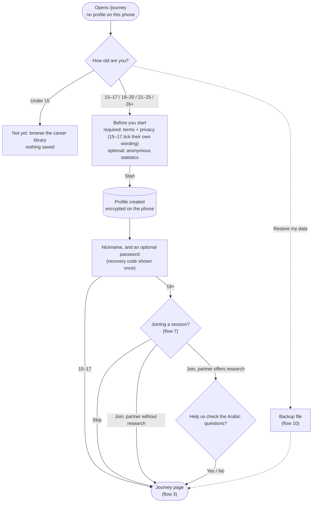

| Step | Screen | Saved on the phone | Sent |
|---|---|---|---|
| Age | Before we start | Nothing yet | — |
| Acceptance (15+) | Before you start | Profile: age band, language, consent (basis `adult_self` or `teen_self`, text version `consent-0.6-draft`, policy version, time), statistics choice | — |
| Nickname and password | Choose a nickname | Nickname; if a password is set, salted hashes of it and its recovery code | — |
| Session code | Joining a session? | The session code and whether it offers research | The code, to check it ([flow 7](#7-pilot-session-code-and-research)) |
| Research | Help us check the Arabic questions? | Research choice and time | — |

**Rules**
- Everyone 15 or older accepts for themselves. There is no parent step: nothing personal reaches anaBokra (counsel agreed, 13 Oct 2026). The 18–20 band stays separate from 21–25.
- Under 15: nothing is saved and the user is pointed to the career library.
- The session-code and research steps appear only for adults.
- **App lock:** with a password set, every later start shows the unlock screen first; no screen can read the profile's data until it's unlocked (`activeRuntime()` returns nothing). Unlocking lasts until the tab or app closes, or "Lock now" in Settings. "Forgot your password?" takes the recovery code and sets a new password (with a new code) or removes it. With neither, the user can only delete the profile, then restore a backup if they have one. The app lock stays on the phone: backups carry the nickname but not the password, so a restored profile opens without one until a new password is set.

**In the code:** `features/local/first-start.tsx`, `profile-setup.tsx`, `unlock-screen.tsx`, `lock-setting.tsx`, `join-session.tsx`, `research-consent.tsx`, `restore-data.tsx`; `lib/local/device.ts` (`DeviceStore.createProfile`, `setConsent`), `lib/local/lock.ts`.

---

## 2. Parent consent (15–17)

**Removed on 13 Oct 2026.** 15–17-year-olds now accept for themselves ([flow 1](#1-first-start)); there is no SMS code, national ID or parent PIN, and nothing personal reaches anaBokra. The earlier flow is in git history (before commit removing `features/local/guardian-consent.tsx`).

---

## 3. The journey and its stations

**Who:** a user with a profile. **Where:** `/assessment` (the journey page) and `/assessment/[station]`.

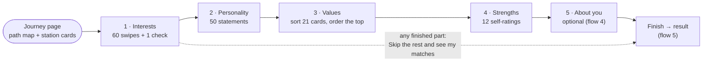

**Inside a station**
1. **Intro** (D1): what the station is about, how long it takes; first-timers also see "how it works".
2. **Questions**: interests are swipe cards (D2), personality uses a 1–5 scale, values is a card sort (D4), strengths uses self-ratings.
3. **Micro-insight** (D8) every 8–10 questions: encouragement and progress, never a score.
4. **Come back later** (D9): available at any time, after the answers are saved.
5. **Station complete** (D10): the next station unlocks.

**Rules**
- Stations unlock in order. A finished station can be reviewed.
- Answers save as they're given (**save queue**). If storage is busy the save is retried; the screen shows "Saving…" or "Saved".
- Leaving and coming back resumes exactly where the user stopped.
- Interests includes one attention-check question; personality includes one too. Neither is scored as a trait.

**Saved on the phone:** each answer with the question id, value and time taken (`assessment:{profileId}` → `responses`), the station progress and the values ranking. **Sent:** nothing.

**In the code:** `features/assessment/*` (hub, station-runner, swipe-card, values-station, micro-insight, save-queue), `features/local/local-station.tsx`, `features/assessment/local-api.ts`, `server/assessment/service.ts` (running on the phone).

---

## 4. About you

**Optional** last station. Every question can be skipped. Picking a different stage clears the answers that belonged to the old one.

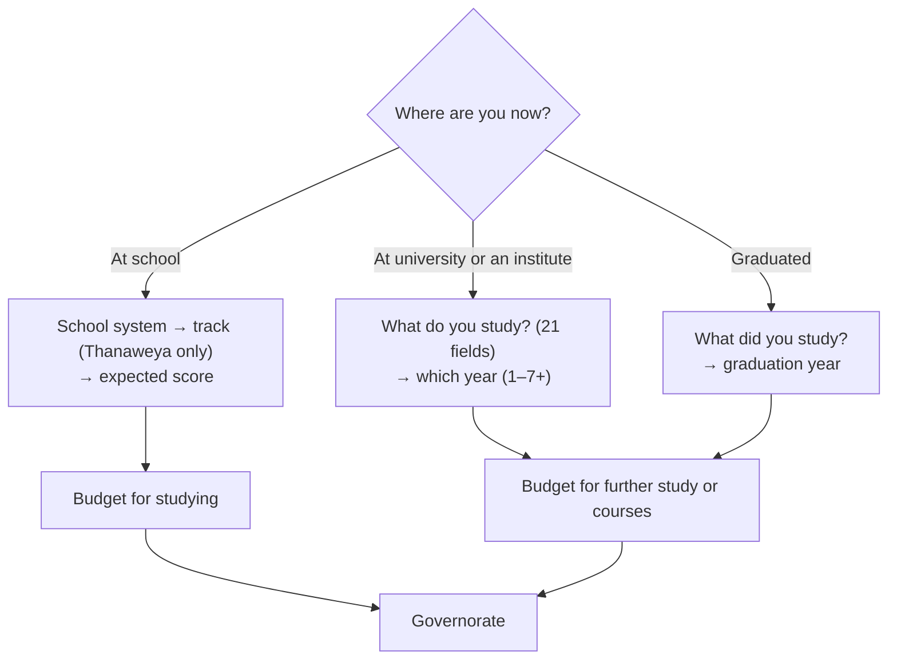

**What it changes:** only the context flags on matches ([flow 5](#5-finishing-and-scoring)). It never removes a career or changes a fit percentage.

| Stage | Flags it can add |
|---|---|
| School | `trackMismatch`, `scoreReach`, `costHigh` (these need Egyptian admission data that isn't loaded yet, so they don't fire today) |
| University / graduate | `fieldMatch` (the field is a usual route in, shown first among the reasons) or `fieldSwitch` (most people come from another field); `costHigh` only when switching |

The usual fields for each career are hand-tagged in `packages/content/careers/study-fields.json`. Careers with no usual field (pilot, entrepreneur, police/military, flight attendant) get neither flag.

**Saved on the phone:** stage, field, year or graduation year, the school answers, budget, governorate. **Sent:** only the stage, inside statistics or research data, and only with an opt-in.

**In the code:** `features/assessment/context-form.tsx`, `packages/engine/src/matching.ts` (`contextFlags`), `server/assessment/config.ts` (`CONTEXT_FIELDS`).

---

## 5. Finishing and scoring

**When:** after the last station, or "Skip the rest and see my matches" once at least one questionnaire can be scored. **Where it runs:** on the phone, in about 25 ms.

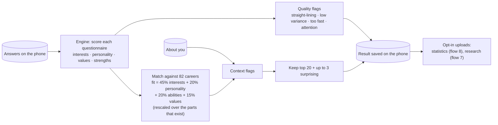

**Rules**
- A result records which questionnaire versions it used and its **coverage** (how much of the four parts it rests on).
- Finishing again for the same session returns the same result.
- A new assessment (**retake**) opens 182 days after the last result.
- Explanations are written when results are shown, from templates in Arabic and English. There is no AI in phase 1.

**In the code:** `server/assessment/scoring.ts` (`scoreSession`), `packages/engine` (`scoring.ts`, `matching.ts`, `quality.ts`), `features/assessment/local-api.ts` (`finalize`).

---

## 6. Results

**Where:** `/assessment/result` and `/assessment/result/[section]`.

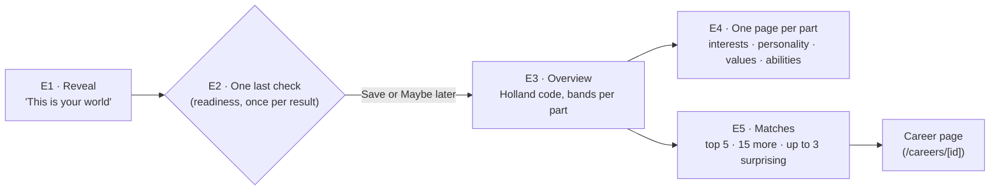

Each **match card** shows the fit %, up to three "Why it fits" reasons (a matching field of study comes first), and "Worth keeping in mind" (watch-outs and caution flags). The **share card** (E6) is turned off in phase 1 because it is rendered on the server.

**Revisiting:** the journey page shows "Your results are ready" with a link to the matches and the retake date.

**In the code:** `features/local/local-result.tsx`, `features/results/*` (reveal, results-flow, matches, profile-overview, section-detail, assemble), `packages/ai/src/templates.ts`.

---

## 7. Pilot session code and research

**Who:** adults at a university pilot session. The app works fully without a code.

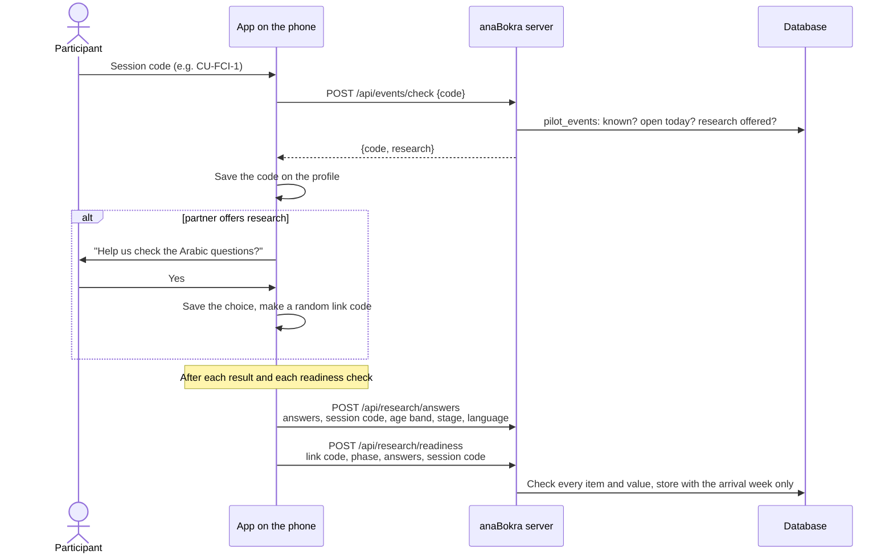

**Main page → University session** lets the user join later, leave, or turn research on or off:

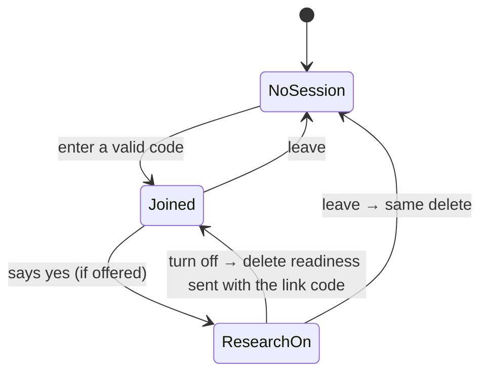

**Rules**
- Codes are 3–20 letters, digits or dashes; one code per partner session. Lower case, spaces and Arabic digits are accepted (`demo ١` → `DEMO-1`). Each code has dates when it can be entered.
- Research is offered only if that partner allows it (some may need an approval first), only to adults, and uploads stop after 17 June 2027.
- Each answer set, path answer set (one per checked path) and readiness record is sent once. The link code and the record of what was sent move with a backup file.
- Turning research off deletes the readiness records sent with the phone's link code. Answer sets carry no code, so they can't be picked out; they are deleted with all research data by 17 June 2027.
- Check limits: 20 code checks per network address per hour; 300 uploads.

**In development:** a session `DEMO-1` (research on) exists. Without a database, `PILOT_EVENTS="CU-FCI-1:research,AUC-1"` lists codes.

**In the code:** `lib/research.ts`, `lib/local/research.ts`, `server/research/*`, `features/local/{join-session,research-consent,session-setting}.tsx`, migration `20261012000001_pilot_research.sql`.

---

## 8. Anonymous statistics

**Who:** users who ticked "Share anonymous statistics" (15–17 decide for themselves). It can be changed under **Anonymous statistics** in Settings.

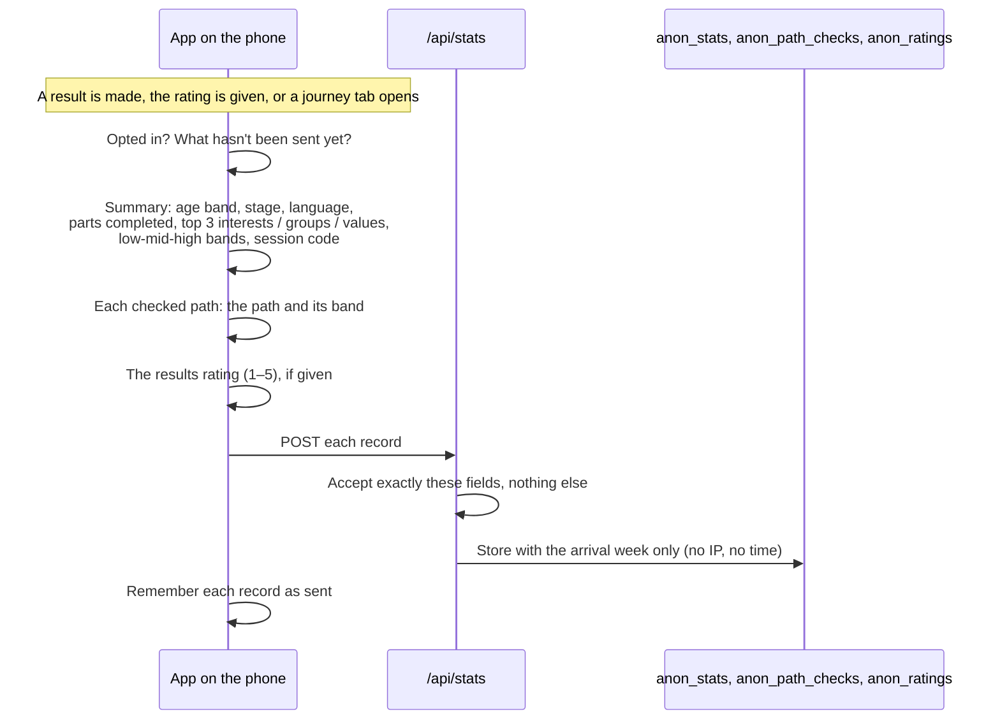

**Rules:** one summary per result, one record per checked path (its first result; checking it again sends nothing), one rating. Records carry the same age band, stage, language and session code, and nothing that links them to each other. If the phone is offline, they're sent the next time a journey tab opens; a failed record doesn't hold up the others. Overlapping triggers share one send. At most 300 per network address per hour (a session shares one university address).

**The results rating** ("My results were clear and useful", 1–5, pilot target 4) is asked on the first path result and at the end of the profile until answered. It's kept in the journey record on the phone either way.

**In the code:** `lib/stats-summary.ts`, `lib/local/stats.ts`, `server/stats/*`, `features/local/stats-setting.tsx`, `features/journey/rating-card.tsx`, migrations `20261011000001_anon_stats.sql` and `20261013000001_anon_paths_ratings.sql`.

---

## 9. Readiness check

Six statements, 1–5 agree, on how ready the user feels to choose a career. It is **the pilot's main measure**: the change between the baseline and the follow-up. See the [pilot plan](../gtm/pilot-plan.md) and the [cohort report template](../gtm/cohort-report-template.md).

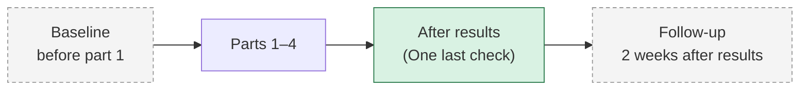

| Point | Status | Stored as |
|---|---|---|
| Baseline (session 1) | **Designed** | `pre` |
| After results | Built (asked once per result; "Maybe later" skips it) | `post` |
| Follow-up (two weeks later) | **Designed** | not decided |

**Open issues**
- **The wording is for school students** ("choosing my major", "universities and programs"); the psychologist is to reword it for 18–25 and freeze it before 15 Nov.
- **The follow-up timing clashes with the 17 Dec data freeze** for later sessions.
- **The anxiety statement may need its own score.** It measures something different from the other five.
- **Which point counts as "after":** the check right after results tends to run high; the pilot measure should use the follow-up.

**In the code:** `packages/content/instruments/readiness.json`, `features/results/readiness-check.tsx`, `server/assessment/service.ts` (`saveReadiness`).

---

## 10. Moving to a new phone

Under **Move to a new phone** in Settings on my island. On the new phone: **Restore my data** at first start. The file never passes through anaBokra (the transfer code through a server relay was removed on 13 Oct 2026).

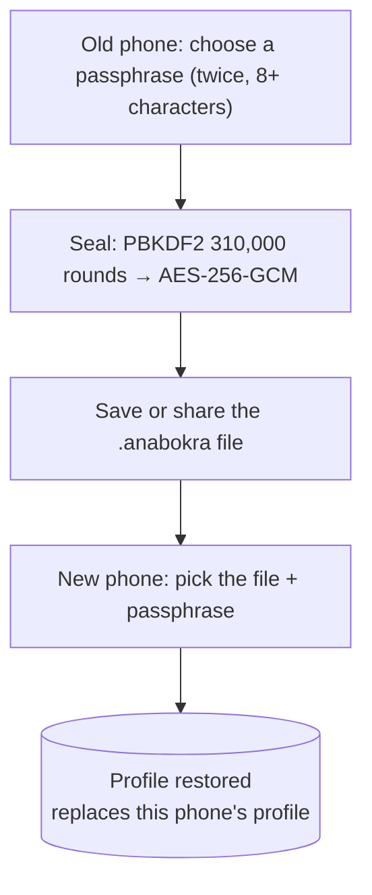

**What moves (the bundle):** the profile (nickname included, app lock left behind), all assessment data (answers, results, readiness, About you), path (Verify) answers and results, and what was already sent (statistics, research, link code).

**In the code:** `lib/local/transfer.ts`, `features/local/{move-data,restore-data}.tsx`.

---

## 11. Delete all my data

**Delete everything?** in Settings on my island (and on the unlock screen, for a forgotten password). It removes the profile and everything stored for it (`profile:`, `assessment:`, `stats:`, `research:`, `journey:` keys) and returns to first start. Data already sent can't be removed this way: anonymous statistics and answer sets can't be traced to a person. Readiness records sent for research are deleted by turning research off first ([flow 7](#7-pilot-session-code-and-research)).

`wipeAll` (developer page only) also throws away the device key.

**In the code:** `features/local/delete-data.tsx`, `DeviceStore.deleteProfile`, `DeviceStore.wipeAll`.

---

## 12. Island world

**Prototype** at `/dev/world`; **designed** in the [world spec](../product/world-spec.md). Not connected to real results yet.

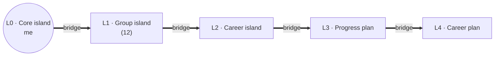

What the prototype shows: the brand-styled 3D world with the core island (it opens the profile), 12 group islands with icons, bridges with progress, scenery, a list view, and sample scenarios. Planned rules (caps of 3 active groups and 2 selected careers, island states, re-scoring as "upgrades") are in the world spec, sections 1–4.

---

## 13. Phase 2 flows (server mode)

Built for `NEXT_PUBLIC_DATA_MODE=server` and switched off in phase 1. Kept here so the names stay known.

| Flow | Screens | Summary |
|---|---|---|
| Sign-in | `/login`, `/verify` | Phone number and a one-time code sent by WhatsApp (`OTP_SENDER`: OpenWA or WhatsApp Cloud API; console in development), through Supabase Auth's send-SMS hook |
| Consent route A: teen invites a parent | B7, B8, J1, J2 | The teen enters the parent's WhatsApp number; the parent opens a link, verifies by code and agrees |
| Consent route B: family account | J3 | A signed-in parent adds a child |
| Consent route C: school | B9 | School staff record that the school holds written consent; students join with a class code |
| Withdrawal | J8 | Pauses the open assessment and locks saving |
| Admin | K1–K22 | Users, assessment analytics, content, feature flags, audit log, system health |
| Saved careers, explore "for you" | F5, G7 | Per account |

The teen and school pilot materials are parked in [../parked/teens](../parked/teens/).

---

## 14. Discover and Verify

Decided 12 Oct 2026; full design in [discover-verify.md](../product/discover-verify.md). It replaces the five stations (flow 3) with short island tasks.

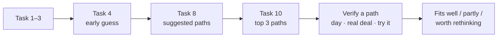

**Discover** (`/journey`): 10 tasks of 9–10 validated questions in mixed formats; each task has one interest card of every type, 2 personality statements (short set) and 1–2 strengths. Answers save on the phone through the same assessment service, so encryption, moving phones, statistics and research all apply. Suggestions are computed live (`service.preview`) and never stored. If every interest answer is the same, the app says no path stands out instead of ranking.

**Verify** (`/journey/[path]`, built for Technology & Data, Business & Finance, Engineering, Health & Medicine): values once, then the path's 3 tasks, saved on the phone under `journey:{profileId}` (moved with backups, deleted with the profile). The result mixes the path's profile fit (50%), enjoyment of its activities (30%) and acceptance of its realities (20%) into fits well / partly / worth rethinking, lists what the user enjoyed, the realities they turned down (with the careers they matter for), and ranks the path's careers.

**The stored result** is made once Discover, values and a first path are all done; opt-in statistics and research are sent from it. **Readiness:** baseline before task 1, follow-up 7 days after the first path result (placeholder timing).

## 15. The tabs

Every journey screen sits in one shell: a top bar and four tabs, **Home · Explore · Saved · Account** (in Arabic the first tab is on the right). Each tab loads the journey from the phone through the same gate, so first start, the unlock screen and refusals behave the same everywhere (`features/journey/journey-gate.tsx`, `app-shell.tsx`).

| Tab | Route | What it holds |
|---|---|---|
| Home | `/journey` | Greeting with the nickname, a map preview (only the user's suggested and added paths are labelled; tapping it opens Explore), readiness checks, Discover tasks, suggested and checked paths |
| Explore | `/journey/map` | The island map or a list, search over fields and careers, the bridge legend, and the island sheet |
| Saved | `/journey/saved` | Paths bookmarked from the island sheet |
| Account | `/journey/account` | Nickname and password, language, anonymous statistics, university session, move to a new phone, delete all my data, legal links |

**Light only, and touch targets.** The app is always light, whatever the phone's setting (`data-theme="light"`, `color-scheme: light`). Every tappable control is at least 44px (buttons 48px by default; `tap-link`, `field`, `surface` and `switch` in `styles/globals.css`); map labels get an invisible 44px tap area; text fields use 16px text so iOS doesn't zoom in.

**Island sheet actions:** *Add to my map* (paths outside the suggestions, or before results) turns the bridge orange; *Remove from my map* undoes it. *Save* bookmarks the path. *Explore this field* opens Verify once suggestions exist and the path has content; otherwise the sheet says why. Career chips open the career pages. *Review my answers* opens the results.

**Stored on the phone:** the journey record (`journey:{id}`) gains `added` and `saved` lists; they move with a backup file and are deleted with the profile. Nothing is sent.

---

## Known gaps

| Gap | Effect | Where |
|---|---|---|
| Rate limits are kept in memory | Fine on one server; lost on restart; not shared across servers | `server/research`, `server/stats` |
| Readiness follow-up timing is a placeholder (7 days) | Must be settled against the 17 Dec data freeze | `FOLLOW_UP_DAYS` |
| Gender not asked in phase 1 | Arabic always uses the masculine form | First start |
| School admission data (tracks, minimum scores, costs) not loaded | School context flags never fire | `CareerEgyptContext` |
| Abilities performance (ICAR) items not supplied | Strengths rests on self-ratings only | `abilities.json` |
| Island world not connected to results | Prototype only | Flow 12 |
| "Strengths" names two different things | Confusing on the results page | [glossary §9](glossary.md#9-naming-issues-to-settle) |
