# User flows

Each flow in phase 1 (on-device mode), step by step, with a diagram, what is stored and what is sent. Words in **bold** are defined in the [glossary](glossary.md). Status labels are explained in the [README](README.md#status-labels).

| # | Flow | Status |
|---|---|---|
| 1 | [First start](#1-first-start) | Built |
| 2 | [Parent consent (15–17)](#2-parent-consent-1517) | Built, gaps |
| 3 | [The journey and its stations](#3-the-journey-and-its-stations) | Built |
| 4 | [About you](#4-about-you) | Built |
| 5 | [Finishing and scoring](#5-finishing-and-scoring) | Built |
| 6 | [Results](#6-results) | Built |
| 7 | [Pilot session code and research](#7-pilot-session-code-and-research) | Built |
| 8 | [Anonymous statistics](#8-anonymous-statistics) | Built |
| 9 | [Readiness check](#9-readiness-check) | Built, gaps |
| 10 | [Moving to a new phone](#10-moving-to-a-new-phone) | Built |
| 11 | [Delete all my data](#11-delete-all-my-data) | Built |
| 12 | [Island world](#12-island-world) | Prototype / Designed |
| 13 | [Phase 2 flows](#13-phase-2-flows-server-mode) | Phase 2 |
| 14 | [Discover and Verify (replacing the stations)](#14-discover-and-verify) | Built (Discover), Prototype (Verify) |
| — | [Known gaps](#known-gaps) | — |

---

## 1. First start

**Who:** anyone opening `/assessment` on a phone with no profile yet. **Nothing is saved until the user (or their parent) agrees.**

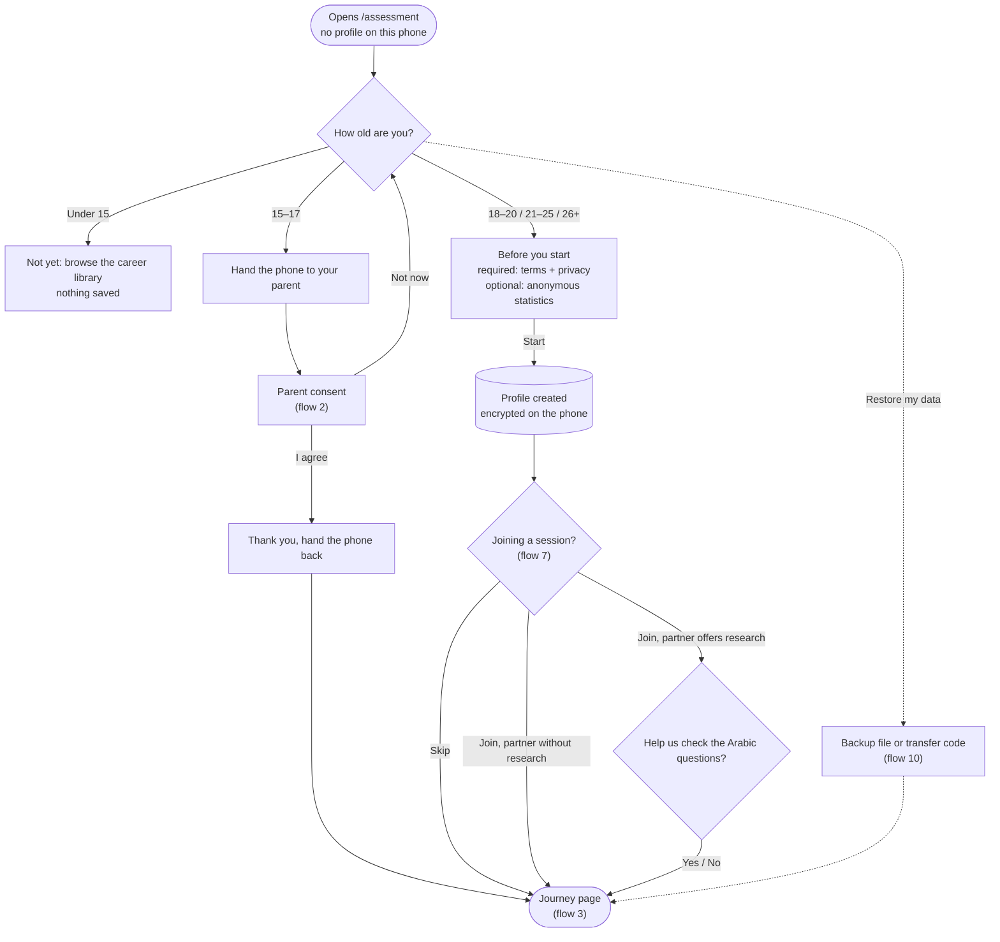

| Step | Screen | Saved on the phone | Sent |
|---|---|---|---|
| Age | Before we start | Nothing yet | — |
| Acceptance (18+) | Before you start | Profile: age band, language, consent (text version `consent-0.4-draft`, policy version, time), statistics choice | — |
| Session code | Joining a session? | The session code and whether it offers research | The code, to check it ([flow 7](#7-pilot-session-code-and-research)) |
| Research | Help us check the Arabic questions? | Research choice and time | — |

**Rules**
- The 18–20 band is kept apart from 21–25 because full legal capacity in Egypt is at 21. Whether 18–20 can accept for themselves is an open question for the lawyer.
- Under 15: nothing is saved and the user is pointed to the career library.
- The session-code and research steps appear only for adults.

**In the code:** `features/local/first-start.tsx`, `join-session.tsx`, `research-consent.tsx`, `restore-data.tsx`; `lib/local/device.ts` (`DeviceStore.createProfile`, `setConsent`).

---

## 2. Parent consent (15–17)

**Who:** the parent or legal guardian, on the young person's phone, right after the hand-over screen.

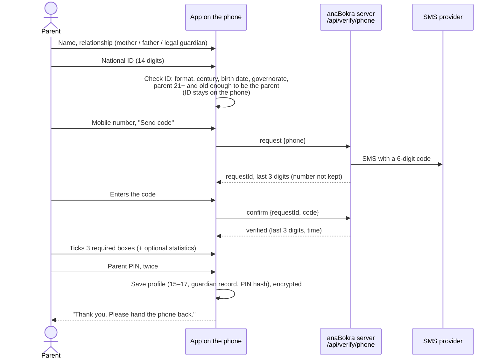

| Kept on the phone (encrypted) | Kept on the server | Never kept |
|---|---|---|
| Parent name, relationship, national ID, last 3 digits of the number, time verified, PIN hash, choices | During the 10 minutes only: a hash of the code, the last 3 digits, attempt count; rate-limit counters keyed by a hash of the number | The phone number |

**Rules**
- The code expires after 10 minutes. 5 wrong tries end the check. Limits: 3 codes per number and 20 per network address per hour.
- Mothers and fathers must be at least 15 years older than a 15-year-old would be; legal guardians are exempt from the age gap. Every parent must be 21 or older.
- The ID's check digit is **not** checked: we found no official rule. An ID check shows the person is an adult; it can't prove they are the parent. The declaration (box 1) covers that.
- The parent PIN is needed to delete data, change the statistics choice, or move the data.
- "Not now" saves nothing.

**Gaps:** no SMS provider is chosen yet. In development the code is printed in the server log; in production sending is refused until an Egyptian provider is added (`server/verify/sms.ts`).

**In the code:** `features/local/guardian-consent.tsx`, `lib/national-id.ts`, `lib/local/pin.ts`, `server/verify/*`, `app/api/verify/phone/{request,confirm}`.

---

## 3. The journey and its stations

**Who:** a user with a profile. **Where:** `/assessment` (the journey page) and `/assessment/[station]`.

**Inside a station**
1. **Intro** (D1): what the station is about, how long it takes; first-timers also see "how it works".
2. **Questions**: interests are swipe cards (D2), personality uses a 1–5 scale, values is a card sort (D4), strengths uses self-ratings.
3. **Micro-insight** (D8) every 8–10 questions: encouragement and progress, never a score.
4. **Come back later** (D9): available at any time, after the answers are saved.
5. **Station complete** (D10): the next station unlocks.

**Rules**
- Stations unlock in order. A finished station can be reviewed.
- Answers save as they're given (**save queue**). If storage is busy the save is retried; the screen shows "Saving…" or "Saved".
- Leaving and coming back resumes exactly where the user stopped.
- Interests includes one attention-check question; personality includes one too. Neither is scored as a trait.

**Saved on the phone:** each answer with the question id, value and time taken (`assessment:{profileId}` → `responses`), the station progress and the values ranking. **Sent:** nothing.

**In the code:** `features/assessment/*` (hub, station-runner, swipe-card, values-station, micro-insight, save-queue), `features/local/local-station.tsx`, `features/assessment/local-api.ts`, `server/assessment/service.ts` (running on the phone).

---

## 4. About you

**Optional** last station. Every question can be skipped. Picking a different stage clears the answers that belonged to the old one.

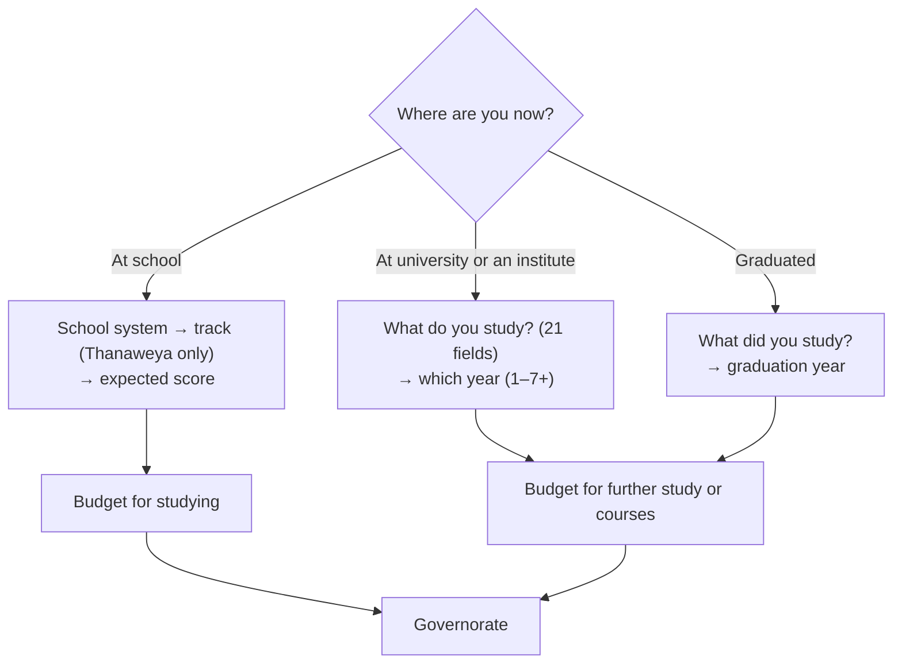

**What it changes:** only the context flags on matches ([flow 5](#5-finishing-and-scoring)). It never removes a career or changes a fit percentage.

| Stage | Flags it can add |
|---|---|
| School | `trackMismatch`, `scoreReach`, `costHigh` (these need Egyptian admission data that isn't loaded yet, so they don't fire today) |
| University / graduate | `fieldMatch` (the field is a usual route in, shown first among the reasons) or `fieldSwitch` (most people come from another field); `costHigh` only when switching |

The usual fields for each career are hand-tagged in `packages/content/careers/study-fields.json`. Careers with no usual field (pilot, entrepreneur, police/military, flight attendant) get neither flag.

**Saved on the phone:** stage, field, year or graduation year, the school answers, budget, governorate. **Sent:** only the stage, inside statistics or research data, and only with an opt-in.

**In the code:** `features/assessment/context-form.tsx`, `packages/engine/src/matching.ts` (`contextFlags`), `server/assessment/config.ts` (`CONTEXT_FIELDS`).

---

## 5. Finishing and scoring

**When:** after the last station, or "Skip the rest and see my matches" once at least one questionnaire can be scored. **Where it runs:** on the phone, in about 25 ms.

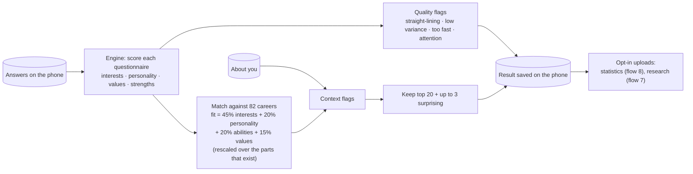

**Rules**
- A result records which questionnaire versions it used and its **coverage** (how much of the four parts it rests on).
- Finishing again for the same session returns the same result.
- A new assessment (**retake**) opens 182 days after the last result.
- Explanations are written when results are shown, from templates in Arabic and English. There is no AI in phase 1.

**In the code:** `server/assessment/scoring.ts` (`scoreSession`), `packages/engine` (`scoring.ts`, `matching.ts`, `quality.ts`), `features/assessment/local-api.ts` (`finalize`).

---

## 6. Results

**Where:** `/assessment/result` and `/assessment/result/[section]`.

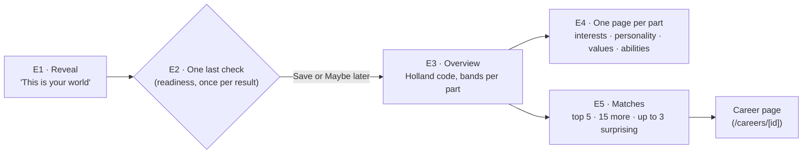

Each **match card** shows the fit %, up to three "Why it fits" reasons (a matching field of study comes first), and "Worth keeping in mind" (watch-outs and caution flags). The **share card** (E6) is turned off in phase 1 because it is rendered on the server.

**Revisiting:** the journey page shows "Your results are ready" with a link to the matches and the retake date.

**In the code:** `features/local/local-result.tsx`, `features/results/*` (reveal, results-flow, matches, profile-overview, section-detail, assemble), `packages/ai/src/templates.ts`.

---

## 7. Pilot session code and research

**Who:** adults at a university pilot session. The app works fully without a code.

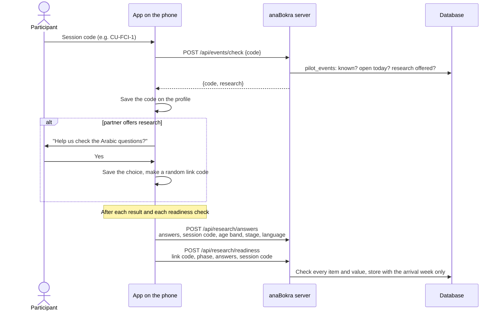

**Main page → University session** lets the user join later, leave, or turn research on or off:

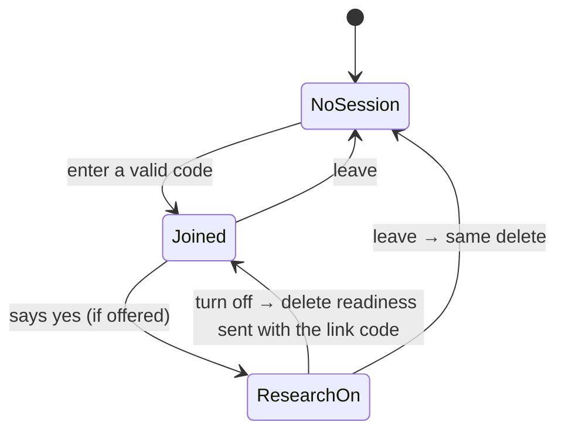

**Rules**
- Codes are 3–20 letters, digits or dashes; one code per partner session. Lower case, spaces and Arabic digits are accepted (`demo ١` → `DEMO-1`). Each code has dates when it can be entered.
- Research is offered only if that partner allows it (some may need an approval first), only to adults, and uploads stop after 17 June 2027.
- Each answer set and readiness record is sent once. The link code and the record of what was sent move with a backup or transfer.
- Turning research off deletes the readiness records sent with the phone's link code. Answer sets carry no code, so they can't be picked out; they are deleted with all research data by 17 June 2027.
- Check limits: 20 code checks per network address per hour; 300 uploads.

**In development:** a session `DEMO-1` (research on) exists. Without a database, `PILOT_EVENTS="CU-FCI-1:research,AUC-1"` lists codes.

**In the code:** `lib/research.ts`, `lib/local/research.ts`, `server/research/*`, `features/local/{join-session,research-consent,session-setting}.tsx`, migration `20261012000001_pilot_research.sql`.

---

## 8. Anonymous statistics

**Who:** users who ticked "Share anonymous statistics" (the parent decides for 15–17). It can be changed under **Anonymous statistics** on the main page; 15–17 need the parent PIN.

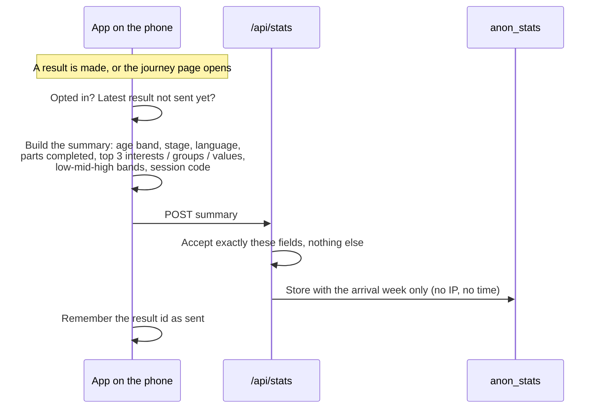

**Rules:** one summary per result. If the phone is offline, it's sent the next time the journey page opens. Overlapping triggers share one send. At most 30 per network address per hour.

**In the code:** `lib/stats-summary.ts`, `lib/local/stats.ts`, `server/stats/*`, `features/local/stats-setting.tsx`, migration `20261011000001_anon_stats.sql`.

---

## 9. Readiness check

Six statements, 1–5 agree, on how ready the user feels to choose a career. It is **the pilot's main measure**: the change between the baseline and the follow-up. See the [pilot plan](../gtm/pilot-plan.md) and the [cohort report template](../gtm/cohort-report-template.md).

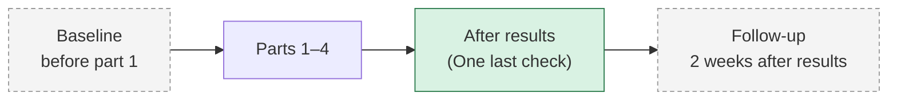

| Point | Status | Stored as |
|---|---|---|
| Baseline (session 1) | **Designed** | `pre` |
| After results | Built (asked once per result; "Maybe later" skips it) | `post` |
| Follow-up (two weeks later) | **Designed** | not decided |

**Open issues**
- **The wording is for school students** ("choosing my major", "universities and programs"); the psychologist is to reword it for 18–25 and freeze it before 15 Nov.
- **The follow-up timing clashes with the 17 Dec data freeze** for later sessions.
- **The anxiety statement may need its own score.** It measures something different from the other five.
- **Which point counts as "after":** the check right after results tends to run high; the pilot measure should use the follow-up.

**In the code:** `packages/content/instruments/readiness.json`, `features/results/readiness-check.tsx`, `server/assessment/service.ts` (`saveReadiness`).

---

## 10. Moving to a new phone

Under **Move to a new phone** on the main page (15–17 need the parent PIN). On the new phone: **Restore my data** at first start.

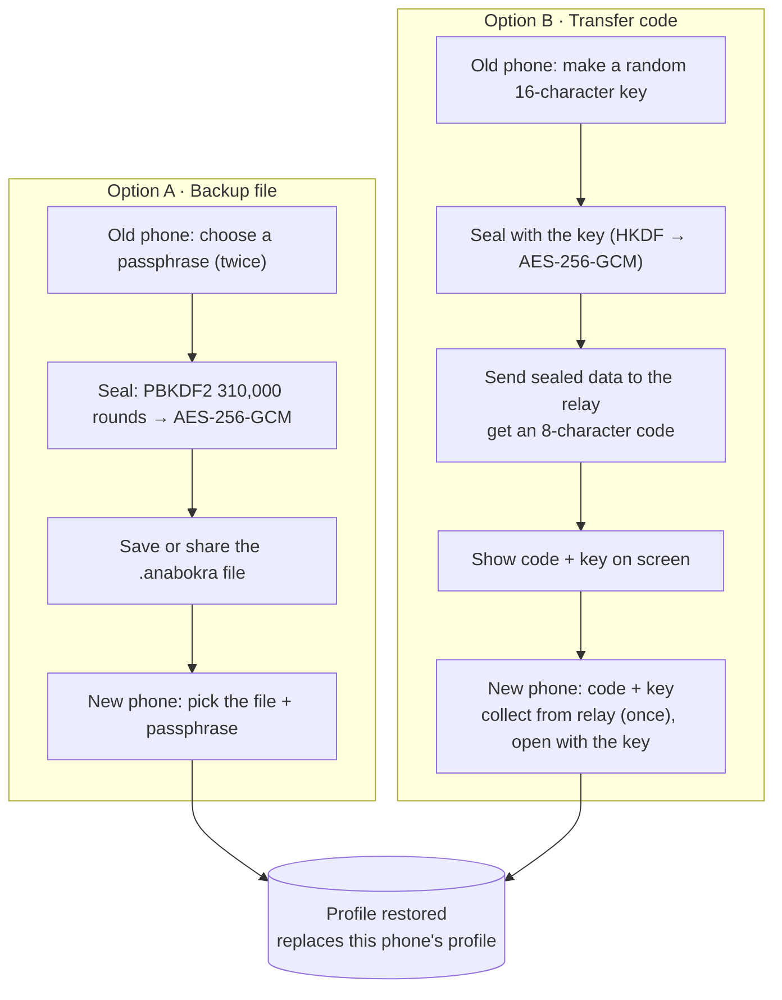

**What moves (the bundle):** the profile (including any parent record), all assessment data (answers, results, readiness, About you), and what was already sent (statistics, research, link code).

**Relay rules:** it holds only sealed data it can't read; up to 2 MB; deleted after 10 minutes or once collected; 10 sends and 30 collections per network address per hour. The key never reaches the server.

**In the code:** `lib/local/transfer.ts`, `features/local/{move-data,restore-data}.tsx`, `server/transfer/*`, `app/api/transfer{,/claim}`.

---

## 11. Delete all my data

**Delete everything?** on the main page (15–17 need the parent PIN). It removes the profile and everything stored for it (`profile:`, `assessment:`, `stats:`, `research:` keys) and returns to first start. Data already sent can't be removed this way: anonymous statistics and answer sets can't be traced to a person. Readiness records sent for research are deleted by turning research off first ([flow 7](#7-pilot-session-code-and-research)).

`wipeAll` (developer page only) also throws away the device key.

**In the code:** `features/local/delete-data.tsx`, `DeviceStore.deleteProfile`, `DeviceStore.wipeAll`.

---

## 12. Island world

**Prototype** at `/dev/world`; **designed** in the [world spec](../product/world-spec.md). Not connected to real results yet.

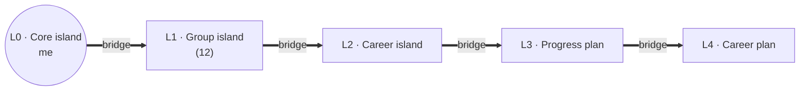

What the prototype shows: the brand-styled 3D world with the core island (it opens the profile), 12 group islands with icons, bridges with progress, scenery, a list view, and sample scenarios. Planned rules (caps of 3 active groups and 2 selected careers, island states, re-scoring as "upgrades") are in the world spec, sections 1–4.

---

## 13. Phase 2 flows (server mode)

Built for `NEXT_PUBLIC_DATA_MODE=server` and switched off in phase 1. Kept here so the names stay known.

| Flow | Screens | Summary |
|---|---|---|
| Sign-in | `/login`, `/verify` | Phone number and a one-time code sent by WhatsApp (`OTP_SENDER`: OpenWA or WhatsApp Cloud API; console in development), through Supabase Auth's send-SMS hook |
| Consent route A: teen invites a parent | B7, B8, J1, J2 | The teen enters the parent's WhatsApp number; the parent opens a link, verifies by code and agrees |
| Consent route B: family account | J3 | A signed-in parent adds a child |
| Consent route C: school | B9 | School staff record that the school holds written consent; students join with a class code |
| Withdrawal | J8 | Pauses the open assessment and locks saving |
| Admin | K1–K22 | Users, assessment analytics, content, feature flags, audit log, system health |
| Saved careers, explore "for you" | F5, G7 | Per account |

The teen and school pilot materials are parked in [../parked/teens](../parked/teens/).

---

## 14. Discover and Verify

Decided 12 Oct 2026; full design in [discover-verify.md](../product/discover-verify.md). It replaces the five stations (flow 3) with short island tasks.

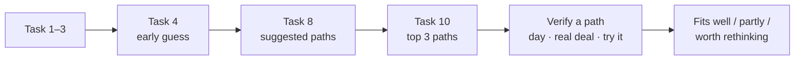

**Discover** (`/journey`): 10 tasks of 9–10 validated questions in mixed formats; each task has one interest card of every type, 2 personality statements (short set) and 1–2 strengths. Answers save on the phone through the same assessment service, so encryption, moving phones, statistics and research all apply. Suggestions are computed live (`service.preview`) and never stored. If every interest answer is the same, the app says no path stands out instead of ranking.

**Verify** (`/journey/[path]`, built for Technology & Data, Business & Finance, Engineering, Health & Medicine): values once, then the path's 3 tasks, saved on the phone under `journey:{profileId}` (moved with backups, deleted with the profile). The result mixes the path's profile fit (50%), enjoyment of its activities (30%) and acceptance of its realities (20%) into fits well / partly / worth rethinking, lists what the user enjoyed, the realities they turned down (with the careers they matter for), and ranks the path's careers.

**The stored result** is made once Discover, values and a first path are all done; opt-in statistics and research are sent from it. **Readiness:** baseline before task 1, follow-up 7 days after the first path result (placeholder timing).

## Known gaps

| Gap | Effect | Where |
|---|---|---|
| Career page "fit" panel, favorites, explore "for you", account still call server endpoints | In phase 1 they show "Sign in and take the assessment" or nothing | `features/careers/personal-context.tsx`, `features/explore/personal-context.tsx`, `/account` |
| Readiness follow-up timing is a placeholder (7 days) | Must be settled against the 17 Dec data freeze | `FOLLOW_UP_DAYS` |
| Statistics and research uploads don't yet include Verify (paths and bands, path answers) | The pilot report can't show path results yet | `stats-summary.ts`, `lib/research.ts` |
| "Clear and useful" rating not built | Pilot plan measure missing | Pilot plan, world spec §6 item 7 |
| Gender not asked in phase 1 | Arabic always uses the masculine form | First start |
| No SMS provider | 15–17 can't verify a parent in production | `server/verify/sms.ts` |
| Relay, code checks and rate limits are kept in memory | Fine on one server; lost on restart; not shared across servers | `server/transfer`, `server/verify`, `server/research` |
| School admission data (tracks, minimum scores, costs) not loaded | School context flags never fire | `CareerEgyptContext` |
| Abilities performance (ICAR) items not supplied | Strengths rests on self-ratings only | `abilities.json` |
| Island world not connected to results | Prototype only | Flow 12 |
| Developer pages (`/dev/local`, `/dev/world`, `/dev/path`, `/dev/engine`) are reachable in production | Anyone could open the demo runner and its "Wipe this device" button | `app/[locale]/dev/*` |
| "Strengths" names two different things | Confusing on the results page | [glossary §9](glossary.md#9-naming-issues-to-settle) |
